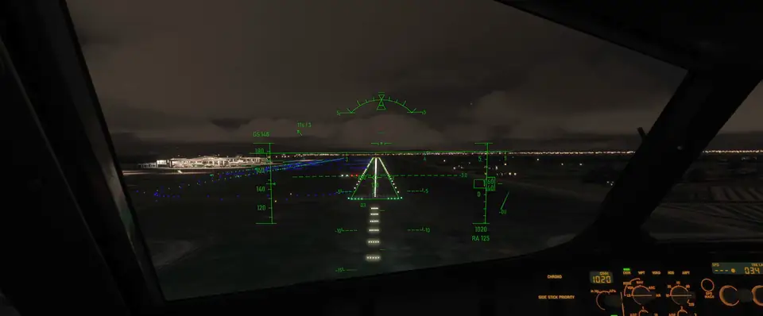
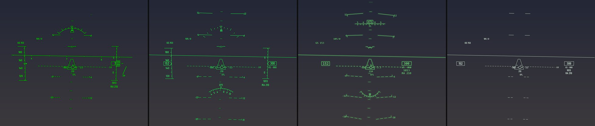

<p align="center"><picture><source media="(prefers-color-scheme: dark)" srcset="res/logo-dark.svg"></picture></p>

# Birdie — a head-up display for MSFS 2024

[中文说明](README.zh-CN.md)

<p align="center"></p>
<p align="center"><sub>Live over MSFS 2024, not added in editing. Fenix A321 SL IAE, ILS 03 at Wenzhou (ZSWZ) at night, the last 17 s: the runway outline sits on the real edges, the touchdown-zone marks land on the painted aiming point, touchdown at 150 fpm.</sub></p>

Birdie is a head-up display overlay for Microsoft Flight Simulator 2024. Its core symbol is the flight path vector
(the "bird"), which marks where the aircraft is actually going — the cue a flat screen lacks when judging the glide
path and touchdown point. Around it Birdie draws conformal symbols registered to the outside view (horizon, pitch
ladder, heading scale, glide-path reference line, runway outline with touchdown-zone marks) and airframe-fixed
instruments (speed, altitude and vertical-speed tapes, bank scale, radio altitude, flare cue).

The symbology has four presets — Airbus (default), Boeing, fighter and minimal — and every element's style, size
and position can be set on its own, as can colour, font, line width and glow.


<sub>Airbus · Boeing · fighter · minimal</sub>

It is an external, transparent, click-through window rendered on the GPU (Direct2D + DirectComposition). Nothing is
injected into the simulator; data comes from SimConnect. An optional toolbar panel lets you adjust it in flight.

> **Status: 0.9.2-beta.** Flown with the FSLabs A321, Fenix A321, FlyByWire A32NX and the C152 on a 21:9 screen.
> Other screen shapes and aircraft should work but are less tested — reports welcome.

## Download

Get the zip from [Releases](https://github.com/Xuan0876/birdie-hud/releases), extract it to a folder of its own and
run `Birdie.exe`. The `README.txt` inside covers install, use, upgrade and uninstall; the manual
(`Birdie-Manual-en.pdf`, `Birdie-Manual-zh-CN.pdf`) explains every symbol, setting and hotkey.

## Requirements

- Windows 10/11 64-bit, MSFS 2024: full screen, borderless or windowed all work (MSFS 2024 is DX12 only, so its
  full screen still lets the HUD window sit on top). VR is not supported: the HUD is a separate window on top of the sim.
- **ChasePlane** (Parallel 42), cockpit view. Birdie reads the camera angles, zoom and eye point from ChasePlane, so
  no calibration is needed. Support for the sim's own camera is planned.
- Any aircraft. No flight director yet.

## Using it

- The bird in the tray: click for the settings, right-click for the menu.
- **Ctrl+Alt+Insert** shows / hides the HUD (changeable in the settings). On the ground it waits until the take-off
  roll passes 40 kt; it can also hide itself at cruise altitude (*Fine tuning → Show / hide by itself*).
- Every setting lives in one page: a tap on a symbol turns it on or off, three scales (size, brightness, glide angle)
  and a folded "fine tuning". The same page opens on the desktop (Birdie's own window, WebView2) and, optionally,
  **in the sim** from the toolbar: *Fine tuning → In-sim panel → Install* writes the package to your Community
  folder (found from `UserCfg.opt`, Store or Steam), and a newer Birdie updates it when it starts.

Birdie talks to the panel over a WebSocket on 127.0.0.1:47820 — never reachable from the network; other websites are
refused. Settings and the log live in `%APPDATA%\Birdie\`.

## Scope

This project is **one plugin that does one thing: the HUD.** Improvements must make the HUD more accurate, nicer,
easier to use or available on more aircraft. Everything else is out of scope ([docs/ROADMAP.md](docs/ROADMAP.md)).

## Building

Needs Visual Studio 2022 (C++ desktop workload, which brings CMake and Ninja) and the MSFS 2024 SDK
(`C:\MSFS 2024 SDK`, or pass `-DMSFS2024_SDK=...`).

```bat
scripts\build.bat
build\release\Birdie.exe
```

`build.bat` configures, builds and runs the tests (`ctest`: unit tests + parity against the reference's golden
output). `Birdie.exe --replay tests\fixtures\lax_dusk_07L` plays a recorded approach over the primary monitor
without the simulator.

- **Panel**: after editing `panel\birdie-panel`, run `python scripts\make_panel.py` (font subsets + `layout.json`;
  needs `pip install fonttools`) and rebuild — the package is built into `Birdie.exe` (`src/app/ingame.h`).
  `Birdie.exe --export-panel <folder>` / `--remove-panel <folder>` install it from the command line.
  `tools/panel_preview` serves the page in a browser with a fake Birdie behind it.
- **Manual**: [docs/manual](docs/manual) (HTML + CSS, Chinese and English). `python scripts\make_manual.py` redraws
  the pictures with `birdie_shot` and the panel preview, then prints both PDFs with Edge into `build\manual`;
  `--pdf` prints only.
- **Release zip**: `python scripts\make_manual.py --pdf`, then `python scripts\package.py` → `dist\Birdie-<version>.zip`
  (`Birdie.exe`, `SimConnect.dll`, [packaging/README.txt](packaging/README.txt), the two manual PDFs, license files). The same zip goes to GitHub Releases and flightsim.to.

## Repository map

| Path | What |
|---|---|
| `src/` | the program: `sim` (SimConnect), `core` (camera model, runway, settings), `hud` (symbols), `render` (Direct2D), `app` (tray, panel server, settings window) |
| `panel/birdie-panel/` | the settings page, also the MSFS toolbar panel (community package) |
| `tests/` | unit tests and parity fixtures recorded in flight |
| `reference/` | the original Python implementation the C++ program was ported from (frozen; parity source) |
| `tools/` | development tools: HUD contact sheets, panel preview, the calibration experiments behind the camera model |
| `docs/` | [REFERENCE.md](docs/REFERENCE.md) (algorithms), [VALIDATION.md](docs/VALIDATION.md), [HUD_BORDER.md](docs/HUD_BORDER.md), [SMOKE_TEST.md](docs/SMOKE_TEST.md), [ROADMAP.md](docs/ROADMAP.md), design notes |

## Known limitations

- The HUD is drawn a little later than the sim frame it belongs to (SimConnect + compositor); a configurable lead
  extrapolates attitude to hide it.
- VR: not supported. The sim's own screenshots and game-capture recordings do not include
  the HUD (capture the display instead).

## Contributing

For now Birdie does not accept pull requests; bug reports and ideas are welcome as
[issues](https://github.com/Xuan0876/birdie-hud/issues). See [CONTRIBUTING.md](CONTRIBUTING.md).

## Credits

Birdie by **Naux**, built together with **Claude Opus 5.5** (Anthropic).

## License

GPL-3.0-only — see [LICENSE](LICENSE). The HUD geometry follows the FlyByWire A32NX HUD (GPL-3.0); details and other
third-party notes in [THIRD_PARTY_NOTICES.md](THIRD_PARTY_NOTICES.md). Not affiliated with Microsoft, Asobo,
Parallel 42, FlyByWire Simulations, FSLabs or Fenix Simulations.
