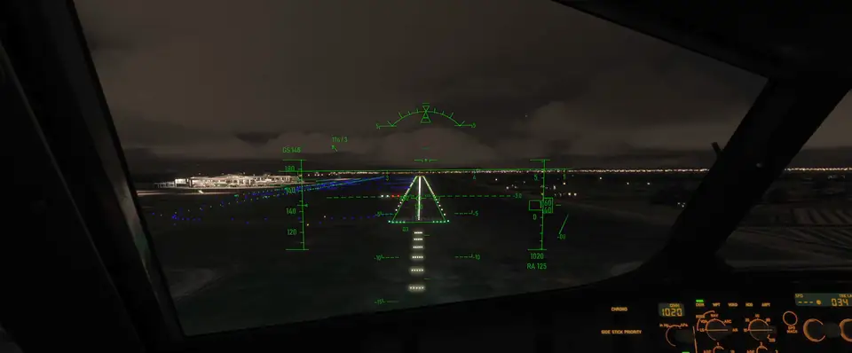
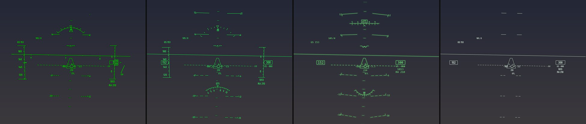

<p align="center"><picture><source media="(prefers-color-scheme: dark)" srcset="res/logo-dark.svg"></picture></p>

# Birdie 小鸟 —— MSFS 2024 平视显示器

[English](README.md)

<p align="center"></p>
<p align="center"><sub>实时盖在 MSFS 2024 上，不是后期加的。Fenix A321 SL IAE，温州龙湾（ZSWZ）03 号跑道夜间 ILS 进近最后 17 秒：跑道框贴住真实道边，接地区标志压在跑道的瞄准点喷漆上，150 fpm 接地。</sub></p>

Birdie（小鸟）是微软模拟飞行 2024 的平视显示器（HUD）覆盖层。核心符号是飞行路径矢量，即"小鸟"：它标出飞机实际飞去的方向，补上 2D 屏幕判断下滑道和接地点时缺少的那条线索。围绕小鸟，Birdie 画出与外界景物对齐的保形符号（地平线、俯仰梯、航向刻度、下滑参考线、带接地区标志的跑道轮廓），以及固定在机体上的仪表（速度带、高度带、升降速度、坡度刻度、无线电高度、拉平提示）。

符号有四套预设：空客（默认）、波音、战斗机、极简；每个元素的样式、大小和位置都能单独设置，颜色、字体、线宽和辉光也可以调。


<sub>空客 · 波音 · 战斗机 · 极简</sub>

它是一个独立的透明窗口，鼠标点击会穿透它，用 GPU（Direct2D + DirectComposition）绘制。不往模拟器里注入任何东西，数据全部来自 SimConnect。另有可选的工具栏面板，飞行中就能调。

> **状态：0.9.2-beta。** 在 21:9 屏幕上用 FSLabs A321、Fenix A321、FlyByWire A32NX 和 C152 实飞过。其他屏幕比例和机型应该能用，但测得少，欢迎反馈。

## 下载

在 [Releases](https://github.com/Xuan0876/birdie-hud/releases) 下载 zip，解压到一个单独的文件夹，运行 `Birdie.exe`。安装、使用、升级、卸载都写在包里的 `README.txt`；每个符号、设置和快捷键的说明在使用说明书里（`Birdie-Manual-zh-CN.pdf`，英文版 `Birdie-Manual-en.pdf`）。

## 需要

- Windows 10/11 64 位；MSFS 2024 全屏、无边框、窗口化都可以（MSFS 2024 只有 DX12，全屏下 HUD 照样叠得上去）。不支持 VR：HUD 是盖在模拟器上面的另一个窗口。
- **ChasePlane**（Parallel 42），驾驶舱视角。Birdie 从 ChasePlane 读镜头角度、缩放和眼点，不需要标定；模拟器原生镜头以后支持。
- 机型不限。暂时没有飞行指引（FD）。

## 使用

- 托盘里的小鸟：单击打开设置，右键是菜单。
- **Ctrl+Alt+Insert** 显示 / 隐藏 HUD（设置里可以改）。在地面上要等起飞滑跑超过 40 kt 才出现；也可以设成巡航高度时自动隐藏（细调 → 自动显示 / 隐藏）。
- 所有设置都在一个页面里：点符号图标开关它，三条刻度（大小、亮度、下滑角），再加一个折起来的"细调"。同一个页面可以在桌面上打开（Birdie 自己的窗口，WebView2），也可以选装到**模拟器里**的工具栏：细调 → 游戏内面板 → 安装，写进从 `UserCfg.opt` 找到的 Community 文件夹（商店版 / Steam 版都行）；新版 Birdie 启动时会自动更新已装的面板。

Birdie 和面板之间用 127.0.0.1:47820 的 WebSocket 通信（外网访问不到，其他网站也连不上）。设置和日志在 `%APPDATA%\Birdie\`。

## 范围

**只做这一个插件，只做 HUD。** 改进必须让 HUD 更准、更好看、更好用，或者能在更多机型上用；其他都不在范围内（[docs/ROADMAP.md](docs/ROADMAP.md)）。

## 编译

需要 Visual Studio 2022（C++ 桌面开发，自带 CMake 和 Ninja）和 MSFS 2024 SDK（默认 `C:\MSFS 2024 SDK`，或用 `-DMSFS2024_SDK=...` 指定）。

```bat
scripts\build.bat
build\release\Birdie.exe
```

`build.bat` 会配置、编译并跑测试（`ctest`：单元测试 + 和参照版标准输出的对照）。`Birdie.exe --replay tests\fixtures\lax_dusk_07L` 不开模拟器、在主显示器上回放一段录好的进近。

- **面板**：改了 `panel\birdie-panel` 之后跑 `python scripts\make_panel.py`（字体子集 + `layout.json`；要先 `pip install fonttools`），再重新编译；社区包整个编进了 `Birdie.exe`（`src/app/ingame.h`）。命令行 `Birdie.exe --export-panel <文件夹>` / `--remove-panel <文件夹>` 也能装 / 删。`tools/panel_preview` 在浏览器里打开页面，后面接一个假的 Birdie。
- **说明书**：[docs/manual](docs/manual)（HTML + CSS，中英两份）。`python scripts\make_manual.py` 用 `birdie_shot` 和面板预览重画配图，再用 Edge 打印两份 PDF 到 `build\manual`；加 `--pdf` 只打印。
- **发布包**：先 `python scripts\make_manual.py --pdf`，再 `python scripts\package.py` → `dist\Birdie-<版本>.zip`（`Birdie.exe`、`SimConnect.dll`、[packaging/README.txt](packaging/README.txt)、两份说明书 PDF、许可证文件）。GitHub Releases 和 flightsim.to 放同一个包。

## 目录

| 路径 | 内容 |
|---|---|
| `src/` | 程序本体：`sim`（SimConnect）、`core`（镜头模型、跑道、设置）、`hud`（符号）、`render`（Direct2D）、`app`（托盘、面板服务、设置窗口） |
| `panel/birdie-panel/` | 设置页面，同时也是 MSFS 工具栏面板（社区包） |
| `tests/` | 单元测试和实飞录下的对照夹具 |
| `reference/` | 最初的 Python 实现，C++ 版就是从它移植的（冻结，作对照基准） |
| `tools/` | 开发工具：HUD 对比图、面板预览、镜头模型背后的标定实验 |
| `docs/` | [REFERENCE.md](docs/REFERENCE.md)（算法）、[VALIDATION.md](docs/VALIDATION.md)、[HUD_BORDER.md](docs/HUD_BORDER.md)、[SMOKE_TEST.md](docs/SMOKE_TEST.md)、[ROADMAP.md](docs/ROADMAP.md)、设计稿 |

## 已知限制

- HUD 比它对应的模拟帧晚一点显示（SimConnect + 合成器）；可调的提前量会外推姿态来抵消。
- 不支持 VR。模拟器自己的截图和"游戏捕获"录像里没有 HUD（请用显示器捕获）。

## 参与

Birdie 暂时不接受 PR；欢迎通过 [Issue](https://github.com/Xuan0876/birdie-hud/issues) 报告 bug 和提建议，详见 [CONTRIBUTING.md](CONTRIBUTING.md)。

## 署名

Birdie 由 **Naux** 制作，与 **Claude Opus 5.5**（Anthropic）协作完成。

## 许可证

GPL-3.0-only，见 [LICENSE](LICENSE)。HUD 几何参考 FlyByWire A32NX HUD（GPL-3.0）；详情和其他第三方说明见 [THIRD_PARTY_NOTICES.md](THIRD_PARTY_NOTICES.md)。与 Microsoft、Asobo、Parallel 42、FlyByWire Simulations、FSLabs、Fenix Simulations 均无关联。
